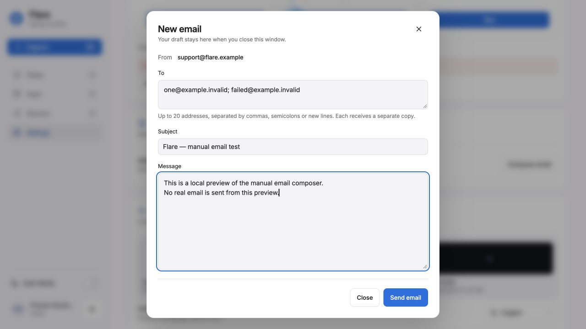
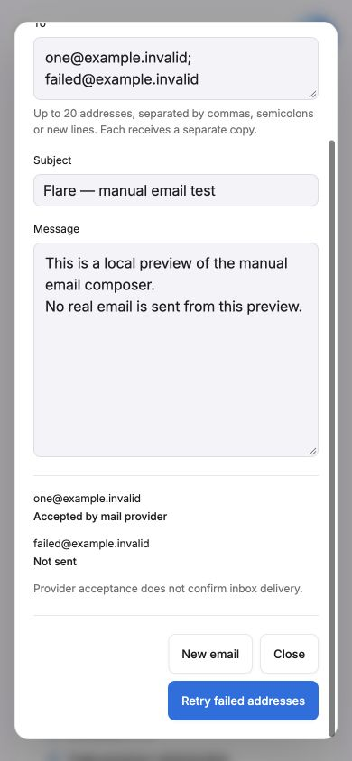

# WEB-007 validation — 2026-10-12

- Backend: 57 focused tests and the complete merged-base suite passed (771 passed,
  419 skipped). One import-runtime test needs `/bin/ps`; the sandboxed full run
  reported 770 passed plus that permission-only failure, and the exact test passed
  separately with process inspection enabled.
  The focused set includes `test_developer_mail.py`, dotenv role isolation, SMTP,
  email and authentication configuration. It covers anonymous and nondeveloper
  denial, pinned-ID/email
  checks, unverified/legal gates, no inherited customer-owner privilege, fail-closed
  policy, header/recipient validation, explicit rejection versus uncertain outcomes,
  the production display-name sender, separate copies, process-wide bounded
  concurrency across simultaneous requests, and the real application's origin guard
  / router wiring. No live database or SMTP was used. Existing Starlette/httpx
  deprecation warning does not affect the result; no dependency upgrade was made.
- Frontend: all 294 merged-base tests passed using the existing lock-file dependencies. Ten mail
  behavioral tests cover paste, permissions, drafts,
  duplicate submission, validation, partial retries, lost-response handling, localized
  copy, authenticated HTTP payloads, and fail-safe handling of unknown proxy errors.
- ESLint, TypeScript checking inside the final Next.js production build, and that
  production build passed. Dependency manifest and lock file are unchanged. No new
  package or version was introduced.
- Browser: final production build on loopback with a synthetic account / API fixture.
  English and Spanish composer rendered. Opening focuses To. Escape closes the
  dialog, restores focus to Compose email, and reopening retains recipients, subject
  and body. Pending controls disable; synthetic partial results show Accepted / Not
  sent and retry only for failed addresses. At 390×844, fields and outcomes fit without
  horizontal overflow; dialog scrolling reaches every footer action. Viewport override
  was reset after the test. All addresses and mail results in the preview are synthetic.
- Whitespace, secret-pattern and declared-file-scope review passed. The database
  schema, import flow and AI analysis scopes are untouched. API configuration now
  owns and isolates the private account grant from worker processes.

## Remaining live checks

No production deployment or private developer grant was changed during this code
validation. Azure already has a resolved SMTP secret reference and the production
display-name sender; live delivery, reply routing and SPF/DKIM/DMARC headers still
require the coordinated rollout and one explicitly agreed test recipient. The earlier
neutral resend-verification response did not establish sending.

The code is ready for review, not accepted or activated on the live website.
